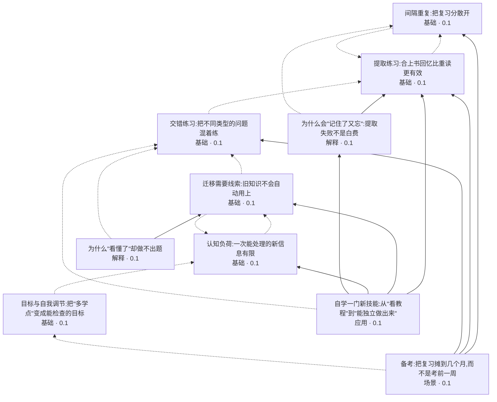

<!-- 由 tools/kgraph.py 自动生成,勿手改 -->
# 知识图谱与可信度(试运行规则 v0)

自身可信度:模型生成未核验 0.1,人工撰写未核验 0.2,每多一位独立的人对当前版本核验通过 +0.2,上限 0.9。
有效可信度:自身可信度与所依据单元的有效可信度取最小。**一条知识不可能比它的地基更可信。**

## 图

实线为"依据"(传递可信度),虚线为"参见"。节点内为有效可信度。

## 单元一览

| 单元 | 层级 | 来源 | 当前版本 | 核验通过人数 | 自身可信度 | 有效可信度 | 被谁卡住 |
|---|---|---|---|---|---|---|---|
| [认知负荷:一次能处理的新信息有限](base-cognitive-load.md) | 基础 | 模型生成(Claude Opus 5.5) | v1 | 0 | 0.1 | **0.1** | —(取决于自身) |
| [目标与自我调节:把"多学点"变成能检查的目标](base-goal-self-regulation.md) | 基础 | 模型生成(Claude Opus 5.5) | v1 | 0 | 0.1 | **0.1** | —(取决于自身) |
| [交错练习:把不同类型的问题混着练](base-interleaving.md) | 基础 | 模型生成(Claude Opus 5.5) | v1 | 0 | 0.1 | **0.1** | —(取决于自身) |
| [提取练习:合上书回忆比重读更有效](base-retrieval-practice.md) | 基础 | 模型生成(Claude Opus 5.5) | v2 | 0 | 0.1 | **0.1** | —(取决于自身) |
| [间隔重复:把复习分散开](base-spacing-effect.md) | 基础 | 模型生成(Claude Opus 5.5) | v1 | 0 | 0.1 | **0.1** | —(取决于自身) |
| [迁移需要线索:旧知识不会自动用上](base-transfer-cues.md) | 基础 | 模型生成(Claude Opus 5.5) | v2 | 0 | 0.1 | **0.1** | —(取决于自身) |
| [为什么会"记住了又忘":提取失败不是白费](exp-why-failed-retrieval-helps.md) | 解释 | 模型生成(Claude Opus 5.5) | v2 | 0 | 0.1 | **0.1** | —(取决于自身) |
| [为什么"看懂了"却做不出题](exp-why-understanding-isnt-ability.md) | 解释 | 模型生成(Claude Opus 5.5) | v2 | 0 | 0.1 | **0.1** | —(取决于自身) |
| [备考:把复习摊到几个月,而不是考前一周](scn-exam-prep-schedule.md) | 场景 | 模型生成(Claude Opus 5.5) | v2 | 0 | 0.1 | **0.1** | —(取决于自身) |
| [自学一门新技能:从"看教程"到"能独立做出来"](app-self-teaching-a-skill.md) | 应用 | 模型生成(Claude Opus 5.5) | v2 | 0 | 0.1 | **0.1** | —(取决于自身) |

## 优先核验顺序

按"有多少单元直接或间接依据它"排序。越靠前,核验它能抬高的下游单元越多。

| 顺序 | 单元 | 层级 | 依据它的下游单元数 | 当前自身可信度 |
|---|---|---|---|---|
| 1 | 提取练习:合上书回忆比重读更有效 | 基础 | 3 | 0.1 |
| 2 | 迁移需要线索:旧知识不会自动用上 | 基础 | 2 | 0.1 |
| 3 | 认知负荷:一次能处理的新信息有限 | 基础 | 1 | 0.1 |
| 4 | 交错练习:把不同类型的问题混着练 | 基础 | 1 | 0.1 |
| 5 | 间隔重复:把复习分散开 | 基础 | 1 | 0.1 |
| 6 | 为什么会"记住了又忘":提取失败不是白费 | 解释 | 1 | 0.1 |
| 7 | 目标与自我调节:把"多学点"变成能检查的目标 | 基础 | 0 | 0.1 |
| 8 | 为什么"看懂了"却做不出题 | 解释 | 0 | 0.1 |
| 9 | 备考:把复习摊到几个月,而不是考前一周 | 场景 | 0 | 0.1 |
| 10 | 自学一门新技能:从"看教程"到"能独立做出来" | 应用 | 0 | 0.1 |

## 完整性检查

- 无问题:引用目标齐全,"依据"无环,依据的引用版本均为最新。
- ℹ️ 有 3 处「参见」指向了旧版本。「参见」不传递可信度,不卡任何指标,所以不必跟进;而且引用图里存在互相引用的单元对,跟进一个就轮到另一个,追不平(链上的 stale_cites 同样只统计「依据」)。
